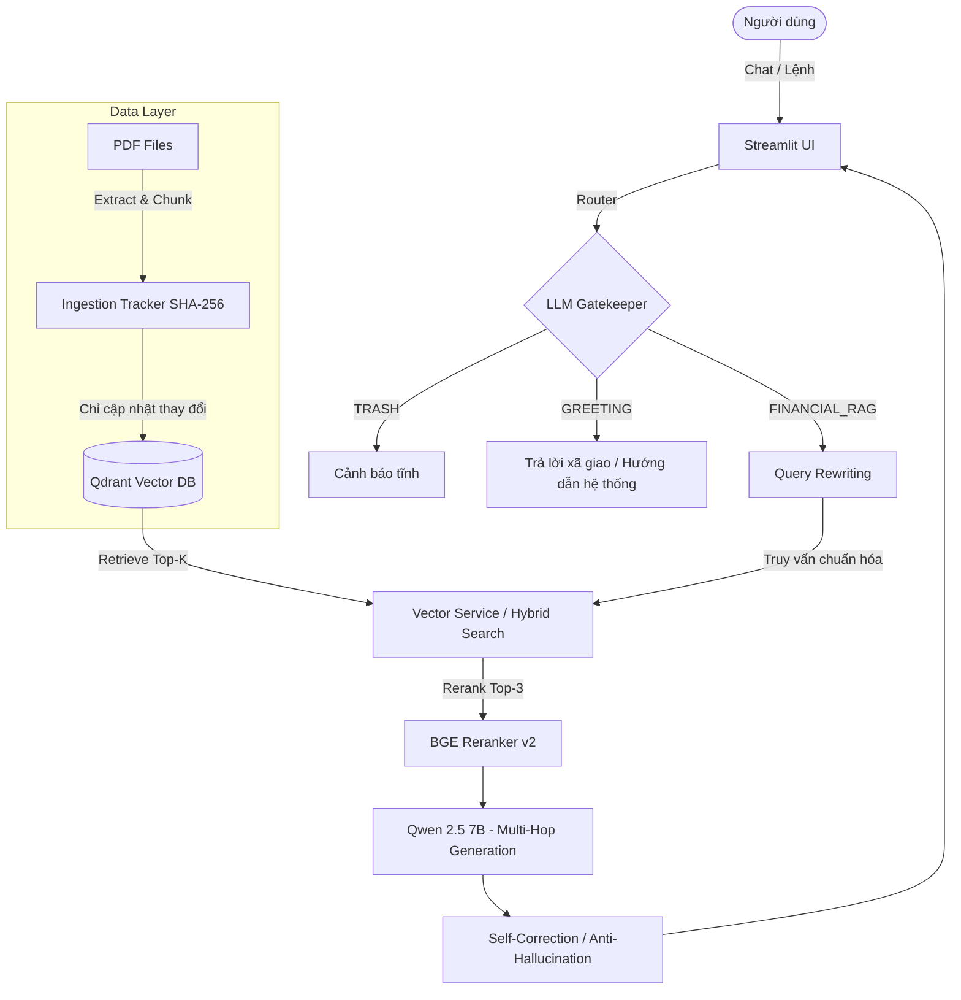

<div align="center">

# 📈 AI Trading Advisory Chatbot — XAUUSD (v2.0)

[](https://www.python.org/downloads/)
[](https://ollama.com/)
[](https://streamlit.io/)
[](https://qdrant.tech/)
[](https://opensource.org/licenses/MIT)

**Hệ thống Cố vấn Giao dịch Vàng (XAUUSD) & Ngoại hối (Forex) sử dụng Kiến trúc Advanced RAG.**  
*Hoàn toàn Offline — Độc lập — Thông minh & Tối ưu hóa hiệu suất.*

</div>

---

## 📖 Giới Thiệu

**Trading Advisory Chatbot** là một nền tảng tư vấn tài chính được phát triển dựa trên sức mạnh của các mô hình ngôn ngữ lớn (LLMs) chạy hoàn toàn cục bộ (offline). Dự án áp dụng kiến trúc **Advanced RAG (Retrieval-Augmented Generation)** để tổng hợp, phân tích dữ liệu vĩ mô, cấu trúc giá (SMC/Price Action), và đưa ra các khuyến nghị giao dịch sát với thực tế, hoàn toàn dựa trên kho tài liệu kiến thức (PDF) của riêng bạn.

Phiên bản **v2.0** đại diện cho một bước nhảy vọt về mặt kiến trúc phần mềm, chuyển đổi từ một ứng dụng monolithic sang **Component-Based Architecture**, đi kèm với cơ chế bảo vệ Guardrails và LLM Gatekeeper nhạy bén.

---

## ✨ Các Tính Năng Đột Phá (v2.0)

### 🧩 1. Kiến Trúc Flexible UI & Facade Pattern
- **Main Shell Gọn Nhẹ:** `app.py` được tối giản hóa chỉ còn làm nhiệm vụ điều phối (Facade).
- **Isolated Components:** Các chức năng Chatbot, Dashboard, và Cài đặt được tách biệt hoàn toàn vào từng module riêng (`src/ui/`). Việc thêm/bớt tính năng không bao giờ làm gãy (break) ứng dụng lõi.

### 🧠 2. Trí Tuệ Nhân Tạo (AI Pipeline) Toàn Diện
- **LLM Gatekeeper (Intent Router v3):** Bức tường lửa phân loại ý định người dùng với độ trễ ~0s. Phân biệt rõ rệt 3 luồng: `GREETING` (Chào hỏi & Hỏi hệ thống), `TRASH` (Rác/Lạc đề), và `FINANCIAL_RAG` (Truy vấn tài chính).
- **Query Rewriting Guardrails:** Chống LLM tự bịa từ khóa (Hallucination). Chỉ mở rộng ngữ nghĩa khi câu hỏi đã chứa thực thể tài chính.
- **Context-Aware Formatting:** Trợ lý không trả lời rập khuôn. Nếu hỏi khái niệm → Giải thích lý thuyết. Nếu hỏi xu hướng → Phân tích từ Vĩ mô đến Kỹ thuật (Entry/SL/TP).
- **Hybrid Search & Reranking:** Kết hợp sức mạnh của Vector Semantics và Keyword Matching, sau đó dùng mô hình Reranker (`BAAI/bge-reranker-v2-m3`) chấm điểm lại để chọn ra top 3 tài liệu chính xác nhất.

### ⚡ 3. Đồng Bộ Thông Minh (Smart Incremental Ingestion)
- Cơ chế quản lý trạng thái tài liệu bằng **Mã băm SHA-256** và **Idempotency**.
- Khác biệt so với truyền thống: Hệ thống chỉ đọc và index **những file PDF mới hoặc bị sửa đổi**, bỏ qua hoàn toàn các file không thay đổi. Giảm thiểu thời gian đồng bộ từ vài phút xuống còn vài mili-giây.

---

## 🏗️ Kiến Trúc Hệ Thống (Architecture Diagram)



---

## 💻 Yêu Cầu Hệ Thống

Dự án hoạt động cục bộ, không tốn phí API nhưng yêu cầu cấu hình phần cứng:

| Thành phần | Yêu cầu tối thiểu | Khuyến nghị (Để mượt mà) |
|:---|:---|:---|
| **OS** | Windows 10/11, macOS, Linux | Ubuntu 22.04+ / Windows 11 |
| **Python** | `3.10.x` | `3.11.x` |
| **RAM** | 8 GB | 16 GB - 32 GB |
| **GPU / VRAM** | CPU-only (Chạy chậm) | NVIDIA RTX (Tối thiểu 6GB VRAM) |
| **Disk** | 10 GB trống | SSD (NVMe để truy xuất Vector DB nhanh) |
| **Ollama** | Đã cài đặt và đang chạy nền | Phiên bản mới nhất |

---

## 🚀 Hướng Dẫn Cài Đặt Khởi Đầu

### 1. Cài đặt Ollama và Model
Tải và cài đặt Ollama từ [trang chủ](https://ollama.com/download). Sau khi cài xong, mở Terminal/PowerShell và kéo model về:
```bash
ollama pull qwen2.5:7b
```
> *Mẹo: Hãy gõ `ollama list` để kiểm tra xem model đã sẵn sàng chưa.*

### 2. Thiết lập dự án

**Clone mã nguồn:**
```bash
git clone https://github.com/DATCAOTAN/Trading_Advisory_Chatbot.git
cd Trading_Advisory_Chatbot
```

**Tạo môi trường ảo (Virtual Environment):**
```bash
# Trên Windows
python -m venv venv
.\venv\Scripts\Activate.ps1

# Trên Linux / macOS
python3 -m venv venv
source venv/bin/activate
```

**Cài đặt thư viện phụ thuộc:**
```bash
pip install -r requirements.txt
```

### 3. Nạp tài liệu kiến thức
Sao chép các file `.pdf` chứa chiến lược giao dịch, lý thuyết SMC, hoặc báo cáo kinh tế của bạn vào thư mục (hệ thống sẽ tự tạo nếu chưa có):
- `data/raw_pdfs/static/`: Cho sách, lý thuyết nền tảng.
- `data/raw_pdfs/dynamic/`: Cho báo cáo tuần, phân tích ngắn hạn.

### 4. Khởi chạy Ứng dụng
Sử dụng tệp `launcher.py` để khởi động an toàn (file này sẽ nạp trước các thư viện AI nặng để chống lỗi crash cục bộ):
```bash
python launcher.py
```
> Giao diện sẽ tự động mở tại: `http://localhost:8501`

---

## 🛠️ Hướng Dẫn Vận Hành Hệ Thống

Giao diện (UI) được chia làm 3 phân hệ độc lập:

1. ⚙️ **Tab Cấu Hình Hệ Thống:**
   - **Đồng Bộ Thông Minh:** Nút bấm quan trọng nhất. Mỗi khi bạn thêm file PDF mới, hãy bấm nút này. Hệ thống sẽ tự động quét và chỉ mã hóa những file thay đổi.
   - **Tính năng AI:** Cho phép bật/tắt `Query Rewriting`, `BGE Reranker`, và `Self-Correction` tùy vào nhu cầu khắt khe hay cần tốc độ phản hồi nhanh.

2. 📊 **Tab Dashboard Tổng Quan:**
   - Cung cấp cái nhìn toàn cảnh về tình trạng hoạt động của Vector DB.
   - Hiển thị chi tiết số lượng Chunk (đoạn dữ liệu) và danh sách các file PDF đã được đưa vào bộ nhớ.

3. 💬 **Tab Chatbot Tư Vấn:**
   - Nhập truy vấn để Bot tư vấn.
   - **Social / Help:** Bạn có thể thử hỏi *"Bạn giúp gì được tôi?"*, *"Hybrid Search là gì?"*. Bot sẽ trả lời như một IT Support mà không gọi tới RAG.
   - **Tài chính:** Hãy hỏi *"Cấu trúc SMC tuần này cho giá Vàng ra sao?"*, bot sẽ tra xuất từ PDF và đưa ra luồng suy luận logic chuyên sâu.

---

## 📂 Cấu Trúc Mã Nguồn (Directory Structure)

Dự án tuân thủ nghiêm ngặt nguyên tắc SOLID và Clean Code:

```text
Trading_Advisory_Chatbot/
├── data/                       # Dữ liệu cục bộ
│   ├── raw_pdfs/               # Chứa các file PDF kiến thức
│   ├── qdrant_db/              # CSDL Vector (Tự sinh)
│   └── ingestion_state.json    # SHA-256 hash file để theo dõi sự thay đổi
├── logs/                       # Tệp tin logs quá trình chạy
├── src/                        # Mã nguồn cốt lõi
│   ├── core/
│   │   └── database.py         # Kết nối Qdrant Database (Singleton)
│   ├── pipelines/
│   │   └── intent_router.py    # LLM Gatekeeper & Phân loại Intent v3
│   ├── services/
│   │   ├── ingestion_tracker.py# Quản lý Idempotency, theo dõi trạng thái PDF
│   │   ├── parser_service.py   # Bóc tách & phân mảnh (Parent-Child Chunking)
│   │   ├── vector_service.py   # Xử lý Vector, Hybrid Search & Reranking
│   │   └── llm_service.py      # Tương tác Ollama API & Multi-Hop Generation
│   ├── ui/                     # Isolated UI Components
│   │   ├── tab_chatbot.py
│   │   ├── tab_dashboard.py
│   │   └── tab_settings.py
│   ├── config.py               # Trung tâm cấu hình thông số kỹ thuật (Path resolve)
│   ├── orchestrator.py         # Bức tường Facade điều phối các dịch vụ
│   └── app.py                  # Streamlit Main Shell
├── launcher.py                 # File khởi động chính, pre-load PyTorch/Arrow
├── test_architecture.py        # Tệp kiểm thử Smoke Test cho kiến trúc
└── requirements.txt            # Thư viện yêu cầu
```

---

## 🛡️ Gỡ Lỗi & Xử Lý Sự Cố (Troubleshooting)

| Vấn đề | Biểu hiện / Lỗi Log | Cách xử lý |
| :--- | :--- | :--- |
| **Lỗi kết nối Ollama** | `ConnectionRefusedError: ...` | Ollama chưa được bật. Hãy mở terminal khác gõ `ollama serve`. |
| **Thiếu mô hình AI** | `model 'qwen2.5:7b' not found` | Gõ lệnh: `ollama pull qwen2.5:7b` để tải. |
| **Qdrant DB bị khóa** | `AlreadyLocked: Database is locked` | Do bạn mở quá nhiều tab Streamlit cùng lúc. Đóng tab thừa và khởi động lại. |
| **Lỗi Import Python** | `ModuleNotFoundError: ...` | Không chạy trực tiếp file trong `src/`. Hãy luôn gọi từ gốc dự án: `python launcher.py`. |

---

## 👨‍💻 Đóng Góp (Contributing)

Chúng tôi hoan nghênh các đóng góp từ cộng đồng (Pull Requests, Issues). Nếu bạn muốn thêm một chiến lược giao dịch mới (VD: Wyckoff, Elliott Waves), xin vui lòng:
1. Fork dự án.
2. Tạo nhánh tính năng (`git checkout -b feature/AmazingFeature`).
3. Commit các thay đổi (`git commit -m 'Thêm tính năng AmazingFeature'`).
4. Push lên nhánh (`git push origin feature/AmazingFeature`).
5. Tạo một Pull Request.

---

## 📜 Giấy Phép (License)

Dự án được phân phối dưới giấy phép **MIT**. Xem tệp `LICENSE` để biết thêm thông tin chi tiết. Hoàn toàn miễn phí cho sử dụng cá nhân và thương mại.
