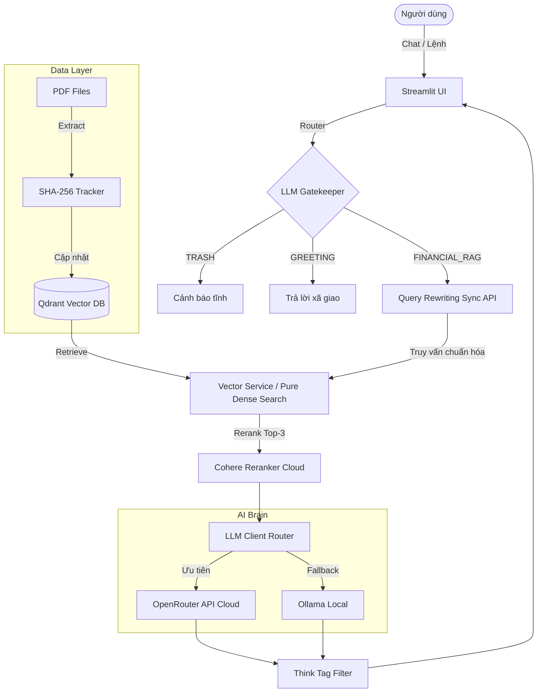

<div align="center">

# 📈 AI Trading Advisory Chatbot — XAUUSD (v3.0)

[](https://www.python.org/downloads/)
[](https://openrouter.ai/)
[](https://aistudio.google.com/)
[](https://cohere.com/)
[](https://ollama.com/)
[](https://streamlit.io/)
[](https://qdrant.tech/)
[](https://www.docker.com/)
[](https://www.mongodb.com/)
[](https://redis.io/)

**Hệ thống Cố vấn Giao dịch Vàng (XAUUSD) & Ngoại hối (Forex) sử dụng Kiến trúc Advanced RAG.**  
*Tốc độ mili-giây với OpenRouter & Cohere Cloud — Tự động Fallback về Local — Trí nhớ vĩnh viễn.*

</div>

---

## 📖 Giới Thiệu

**Trading Advisory Chatbot** là một nền tảng tư vấn tài chính được phát triển dựa trên sức mạnh của các mô hình ngôn ngữ lớn (LLMs). Dự án áp dụng kiến trúc **Advanced RAG (Retrieval-Augmented Generation)** để tổng hợp, phân tích dữ liệu vĩ mô, cấu trúc giá (SMC/Price Action), và đưa ra các khuyến nghị giao dịch sát với thực tế, hoàn toàn dựa trên kho tài liệu kiến thức (PDF) của riêng bạn.

Phiên bản **v3.0 (Cloud Migration)** đánh dấu một bước đại nhảy vọt về hiệu năng: Loại bỏ hoàn toàn nút thắt cổ chai phần cứng bằng việc chuyển dịch luồng suy luận lên **OpenRouter (NVIDIA Nemotron 120B)** và **Cohere Reranker** (tốc độ mili-giây), kết hợp cùng **Bộ nhớ hội thoại toàn cục (Global Session Memory)** và **Bộ lọc tư duy thông minh (Think Tag Filter)**.

---

## ✨ Các Tính Năng Đột Phá (v3.0)

### 🚀 1. Dynamic LLM Router & Tốc độ ánh sáng
- **OpenRouter Cloud Integration:** Kết nối thẳng với dòng model siêu khủng NVIDIA Nemotron 120B chuyên ngành tài chính, mang lại tốc độ Stream text theo thời gian thực.
- **Cohere Reranker API:** Rút phích cắm hệ thống BGE Reranker cục bộ để chuyển lên Cloud với tốc độ xé gió, tiết kiệm hàng GB RAM máy trạm.
- **Auto Fallback Mechanism:** Cơ chế tự động phòng vệ. Nếu mạng mất kết nối hoặc API bị nghẽn, hệ thống tự động đánh lái êm ái luồng xử lý về **Ollama Local** mà không làm crash ứng dụng.
- **Stream Think Tag Filter:** Tự động lọc sạch các nội dung lập luận nội bộ (`<think>...</think>`) trên luồng Stream, đảm bảo UI luôn sạch sẽ và chuyên nghiệp.

### 🧠 2. Global Conversation Memory (Hybrid Storage & Multi-session)
- **Hybrid Storage Bất Tử:** Lịch sử chat được lưu trữ kép (Redis Cache + MongoDB Persistent). Cơ chế Fallback thông minh: Dù Redis bị flush hoàn toàn do khởi động lại server, hệ thống vẫn tự động câu (fetch) lại toàn bộ tin nhắn cũ từ MongoDB để nạp ngược lại vào Cache.
- **Push-Only Safety (Chống ghi đè):** Sử dụng toán tử `$push` ở tầng Database giúp bảo toàn 100% lịch sử vĩnh viễn, tuyệt đối không xảy ra tình trạng ghi đè (overwrite) xóa mất dữ liệu cũ dù hệ thống RAM có bị sai lệch hoặc reset.
- **Multi-session Management:** Hỗ trợ đa phiên trò chuyện. Tích hợp cơ chế tự động bảo vệ Session ID (Graceful Handling): Không tự sinh rác UUID mới nếu kết nối CSDL bị gián đoạn hoặc timeout.
- **Context-Aware Intent Router (Gatekeeper):** Kế thừa bộ nhớ hội thoại để phân loại. Thông minh vượt trội khi tự nhận biết các lệnh yêu cầu hệ thống như *"tóm tắt cuộc hội thoại"*, *"nãy giờ nói gì"* để cho phép qua cổng (pass-through) vào RAG Pipeline mà không cần phải gượng ép người dùng chèn thêm từ khóa tài chính.

### 🧩 3. Kiến Trúc Flexible UI & Facade Pattern
- **Isolated Components:** Các chức năng Chatbot, Dashboard, và Cài đặt được tách biệt hoàn toàn vào từng module riêng (`src/ui/`). Việc thêm/bớt tính năng không bao giờ làm gãy (break) ứng dụng lõi.
- **Context Trimming:** Tối ưu hóa số lượng tài liệu giữ lại (Top-3) sau khi Rerank qua Cohere, giúp giảm tải token nhồi vào LLM và tăng cường độ tập trung cho câu trả lời.

### ⚡ 4. Đồng Bộ Thông Minh (Smart Incremental Ingestion)
- Chống lãng phí CPU bằng cơ chế quản lý trạng thái tài liệu với **Mã băm SHA-256**. Hệ thống chỉ đọc và index **những file PDF mới hoặc bị sửa đổi**, bỏ qua hoàn toàn các file cũ.

### 🌐 5. Live Data Integration (Thời gian thực)
- **Lịch Kinh Tế ForexFactory (Bypass Cloudflare):** Tự động cào dữ liệu lịch kinh tế tuần, tích hợp cơ chế chống Rate Limit (Lỗi 429) bằng Memory Cache và thuật toán ngụy trang User-Agent. Tự động quy đổi toàn bộ sự kiện sang **UTC+7 (Giờ Việt Nam)**.
- **Giá Vàng (XAUUSD) Thời Gian Thực:** Trang bị Live API (với Yahoo Finance Fallback) để lấy giá thị trường và nến (Candle) ngay tại khoảnh khắc trò chuyện, đảm bảo Agent luôn đưa ra nhận định dựa trên giá trị sát thực tế nhất.

---

## 🏗️ Kiến Trúc Hệ Thống (Architecture Diagram)



---

## 💻 Yêu Cầu Hệ Thống

| Thành phần | Yêu cầu cấu hình |
|:---|:---|
| **OS** | Windows 10/11, macOS, Linux |
| **Hệ thống** | Đã cài đặt **Docker** và **Docker Compose** |
| **Phần cứng** | Tối thiểu 8GB RAM (Đủ chạy Streamlit, Redis, Mongo, Qdrant) |
| **API** | API Key của Google AI Studio (hoặc OpenRouter) & Cohere API |
| **Ollama** *(Tùy chọn)* | Cài đặt nếu bạn muốn có hệ thống Fallback nội bộ phòng khi rớt mạng |

---

## 🚀 Hướng Dẫn Cài Đặt Khởi Đầu

### 1. Thiết lập dự án

**Clone mã nguồn:**
```bash
git clone https://github.com/DATCAOTAN/Trading_Advisory_Chatbot.git
cd Trading_Advisory_Chatbot
```

### 2. Cấu Hình API (OpenRouter, Google & Cohere)
Đổi tên file `.env.example` thành `.env` (hoặc tạo file `.env` mới) tại thư mục gốc và nhập cấu hình:
```env
LLM_PROVIDER=google
GOOGLE_API_KEY=AIzaSy_your_api_key_here
GOOGLE_MODEL_NAME=gemini-2.5-flash

OPENROUTER_API_KEY=sk-or-v1-...
OPENROUTER_MODEL_NAME=nvidia/nemotron-3-super-120b-a12b:free

COHERE_API_KEY=your_cohere_api_key_here
```

### 3. Nạp tài liệu kiến thức
Sao chép các file `.pdf` chứa chiến lược giao dịch của bạn vào:
- `data/raw_pdfs/static/`: Cho sách, lý thuyết nền tảng.
- `data/raw_pdfs/dynamic/`: Cho báo cáo vĩ mô tuần/tháng.

### 4. Khởi chạy Ứng dụng (Docker)
Nhờ kiến trúc Containerized, bạn chỉ cần gõ 1 lệnh duy nhất để hệ thống tự động tải và liên kết toàn bộ Database (Redis, Mongo) và giao diện Streamlit:
```bash
docker-compose up --build -d
```
> Giao diện sẽ tự động mở tại: `http://localhost:8501`

---

## 📂 Cấu Trúc Mã Nguồn (Directory Structure)

```text
Trading_Advisory_Chatbot/
├── data/
│   ├── raw_pdfs/               # Chứa file PDF đầu vào
│   ├── qdrant_db/              # Thư mục map với Volume của VectorDB
│   └── ingestion_state.json    # Trạng thái hash SHA-256
├── src/                        
│   ├── core/
│   │   ├── database.py         
│   │   └── llm_client.py       # Dynamic LLM Router & Stream Filter (Mới)
│   ├── pipelines/
│   │   └── intent_router.py    
│   ├── services/
│   │   ├── history_service.py  # Quản lý Session State & Hybrid Cache
│   │   ├── live_data_service.py# Lấy Giá Vàng & Lịch Kinh tế Live
│   │   ├── vector_service.py   # Cohere Embed & Reranker Cloud
│   │   └── llm_service.py      # LLM Agent
│   ├── ui/                     
│   ├── config.py               
│   ├── orchestrator.py         
│   └── app.py                  
├── docker-compose.yml          # Trình điều phối Container (Mới)
├── Dockerfile                  # Đóng gói Streamlit App (Mới)
├── .env.example                
├── launcher.py                 
└── requirements.txt            
```

---

## 👨‍💻 Đóng Góp (Contributing)
Hoan nghênh các đóng góp từ cộng đồng! Hãy Fork, tạo nhánh `feature/`, Commit và gửi Pull Request.

## 📜 Giấy Phép (License)
Dự án được phân phối dưới giấy phép **MIT**. Hoàn toàn miễn phí cho sử dụng cá nhân và thương mại.
