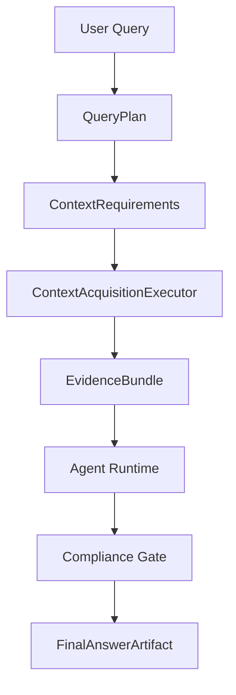
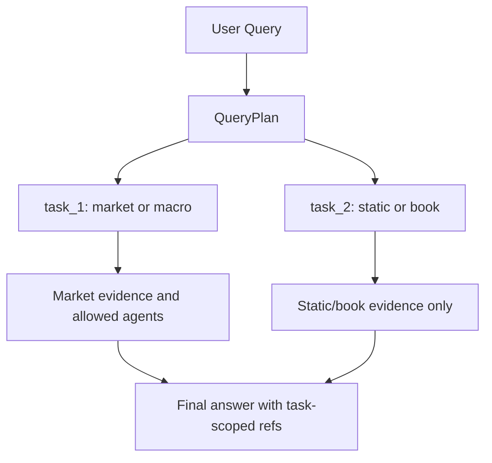
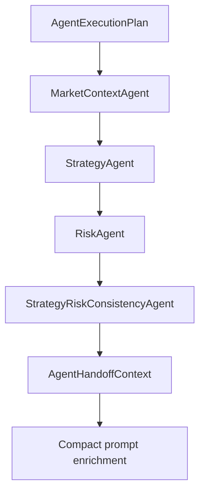
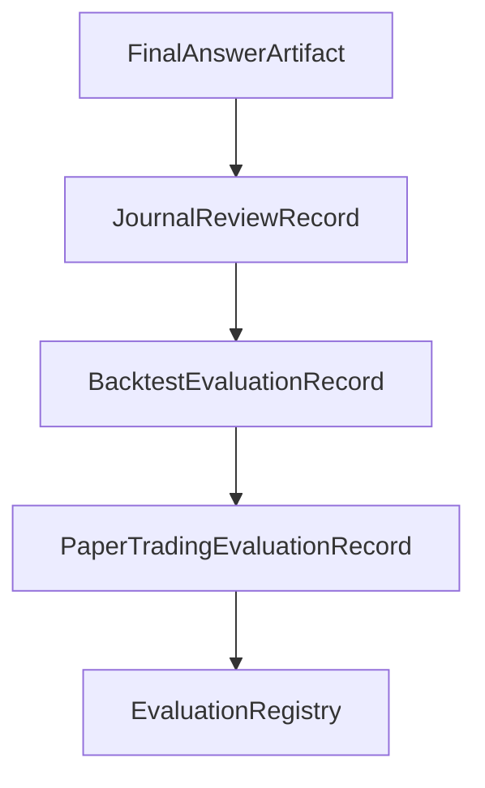
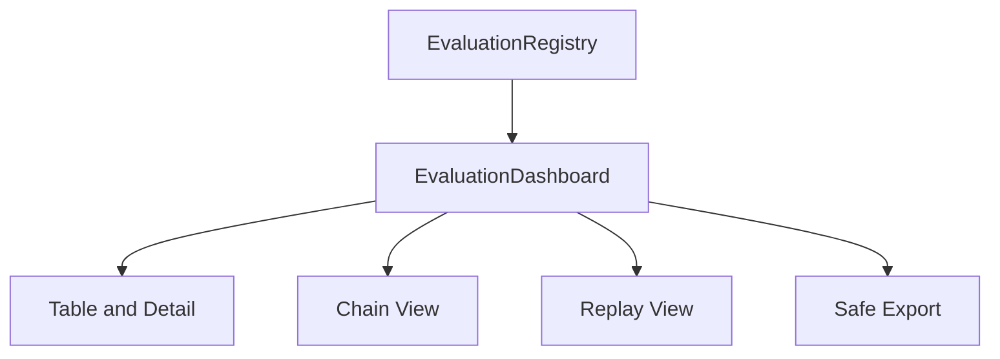
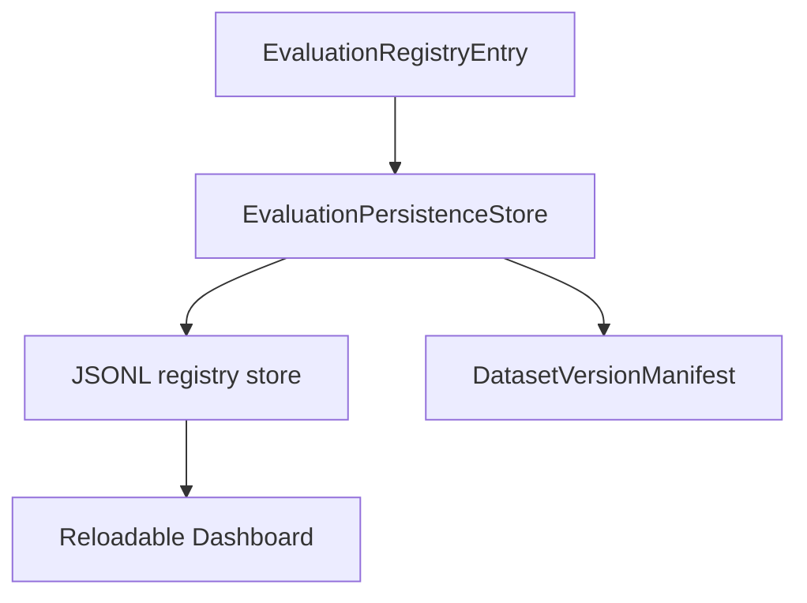
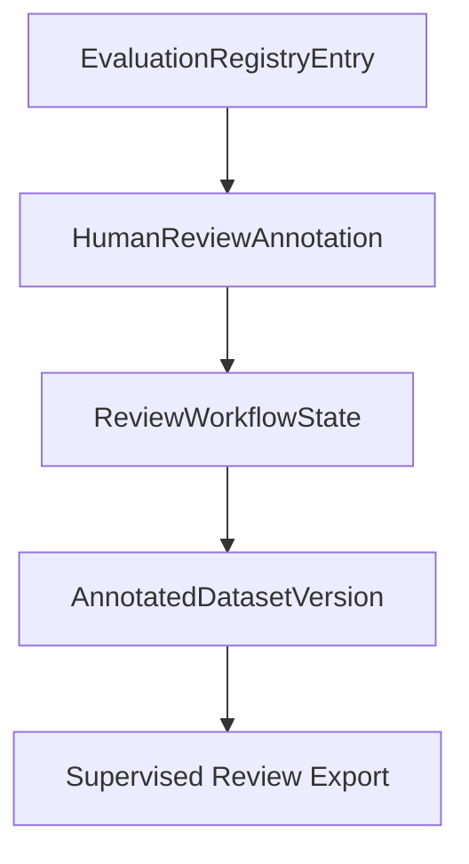
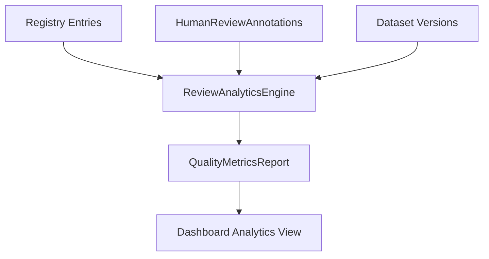
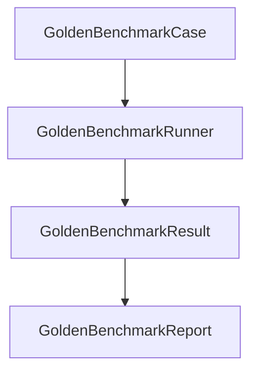
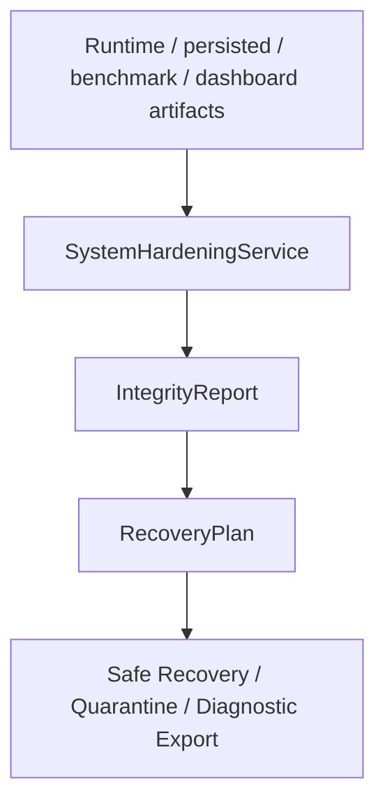

# Data Flow

## 1. Normal Answer Flow

## 2. Multi-Intent Flow

## 3. Agent Handoff Flow

## 4. Evaluation Artifact Flow

## 5. Dashboard / Review Flow

## 6. Persistence / Reload Flow

## 7. Human Annotation Flow

## 8. Analytics Flow

## 9. Benchmark Flow

## 10. Hardening / Recovery Flow

